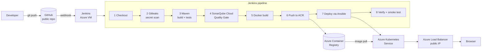

# End-to-End Cloud CI/CD Pipeline on Microsoft Azure

A Java web application built, tested, scanned, containerised and deployed to
**Azure Kubernetes Service** automatically on every push to `main`.

**CIA-2 — Design and Implementation of an End-to-End Cloud-Based CI/CD Pipeline**

---

## Architecture



| Layer | Technology |
|---|---|
| Source control | Git + GitHub (public repository, webhook trigger) |
| Build & test | Maven 3.9 (wrapper), Java 21, JUnit 5, JaCoCo |
| Secret scanning | **Gitleaks** — scans full Git history, fails the build on any finding |
| Static analysis | **SonarQube Cloud** — bugs, vulnerabilities, code smells, coverage, Quality Gate |
| Containerisation | Docker, multi-stage build, non-root distroless-style Alpine JRE |
| Registry | Azure Container Registry (ACR) |
| Orchestration | Azure Kubernetes Service (AKS), 2 replicas, rolling update, HPA |
| CI/CD engine | Jenkins (declarative `Jenkinsfile`) on an Azure Ubuntu VM |
| Config management | Ansible — provisions the Jenkins VM and drives the AKS deployment |

---

## Repository layout

```
.
├── Jenkinsfile                  8-stage declarative CI/CD pipeline
├── pom.xml                      Maven build, JaCoCo + Sonar configuration
├── mvnw, mvnw.cmd, .mvn/        Maven wrapper (no Maven install needed)
├── Dockerfile                   Multi-stage image, runs as UID 10001
├── .dockerignore                Keeps build context small and secret-free
├── .gitleaks.toml               Secret-scanning rules + documented allowlist
├── .env.example                 Config template (never a real secret)
│
├── src/main/java/com/example/cicd/
│   ├── CicdDemoApplication.java
│   ├── config/AppProperties.java     Build metadata injected by the pipeline
│   ├── controller/HomeController.java        HTML landing page
│   ├── controller/GreetingApiController.java REST API
│   ├── model/                                Response records
│   └── service/                              Business logic
├── src/main/resources/
│   ├── application.yml          Actuator probes, externalised config
│   ├── templates/index.html     Page that proves which build is live
│   └── static/css/app.css
├── src/test/java/...            29 unit tests (95.7% instruction coverage)
│
├── k8s/
│   ├── 00-namespace.yaml  01-configmap.yaml  02-deployment.yaml
│   ├── 03-service.yaml    04-hpa.yaml
│   └── render.sh                 Substitutes the build's image tag
│
├── ansible/
│   ├── ansible.cfg  inventory.ini
│   ├── jenkins-setup.yml         Configuration management: builds the CI server
│   └── deploy-app.yml            Deployment automation: renders + applies manifests
│
├── infra/
│   ├── azure-setup.sh            Creates RG, ACR, AKS, VM, service principal
│   └── azure-teardown.sh         Deletes everything (stops credit burn)
│
└── docs/
    ├── SETUP.md                  Step-by-step runbook
    ├── REPORT.md                 Technical report
    └── screenshots/              Evidence for submission
```

---

## Quick start

Full instructions are in **[docs/SETUP.md](docs/SETUP.md)**. In short:

```bash
# 1. Provision Azure (resource group, ACR, AKS, Jenkins VM, service principal)
bash infra/azure-setup.sh
```

```bash
# 2. Configure the Jenkins VM with Ansible (from WSL / Linux / macOS)
cd ansible && ansible-playbook -i inventory.ini jenkins-setup.yml
```

Then add the four Jenkins credentials, point a Pipeline job at this repository,
add the GitHub webhook, and push a commit.

### Run the application locally

```bash
./mvnw spring-boot:run
```

Then open <http://localhost:8080>.

```bash
./mvnw clean verify
```

Runs the 29 unit tests and writes the JaCoCo coverage report to
`target/site/jacoco/index.html`.

```bash
docker build -t cicd-demo-app:local . && docker run --rm -p 8080:8080 cicd-demo-app:local
```

Builds and runs the container image exactly as the pipeline does.

---

## Endpoints

| Endpoint | Purpose |
|---|---|
| `/` | Landing page showing the live image tag, build number, commit and pod name |
| `/api/v1/greeting?name=X` | JSON greeting plus the pod that served the request |
| `/api/v1/info` | Build metadata — used by the pipeline's smoke test |
| `/actuator/health` | Overall health |
| `/actuator/health/liveness` | Kubernetes liveness probe |
| `/actuator/health/readiness` | Kubernetes readiness probe |

---

## Demonstrating a change flowing through the pipeline

Edit the release message, commit and push:

```bash
sed -i 's/APP_RELEASE_MESSAGE: .*/APP_RELEASE_MESSAGE: "Release 2 - shipped automatically"/' k8s/01-configmap.yaml && git commit -am "Update release message" && git push
```

The webhook fires, Jenkins runs all eight stages, a new image tag
`<build>-<commit>` appears in ACR, AKS performs a zero-downtime rolling update,
and the new message plus the new build number are visible in the browser.

---

## Cost control

AKS nodes, the Jenkins VM and the Load Balancer bill per hour against your
Azure credits. Between demo sessions:

```bash
az aks stop --resource-group rg-cicd-cia2 --name aks-cicd-cia2 && az vm deallocate --resource-group rg-cicd-cia2 --name vm-jenkins
```

When finished for good:

```bash
bash infra/azure-teardown.sh
```
